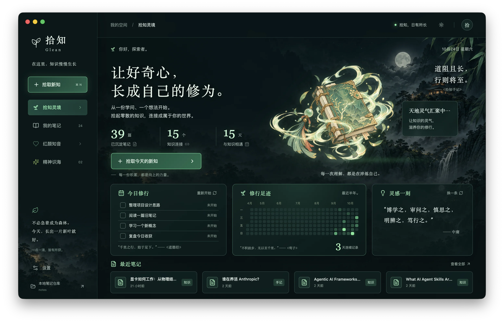
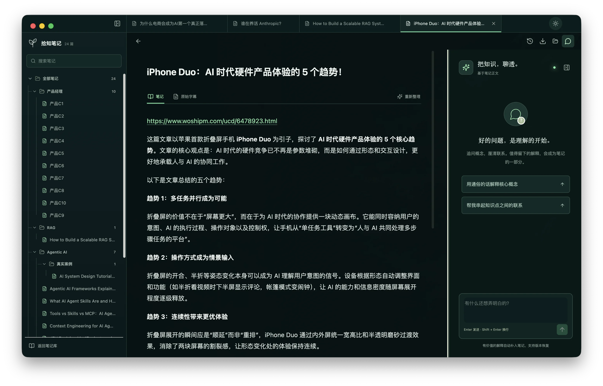
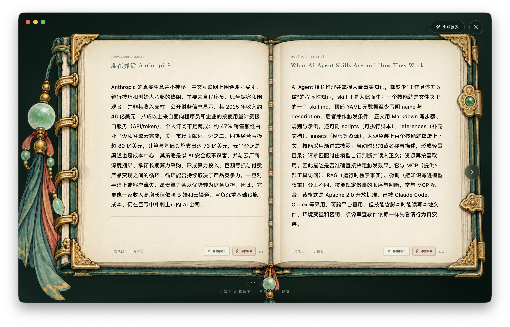
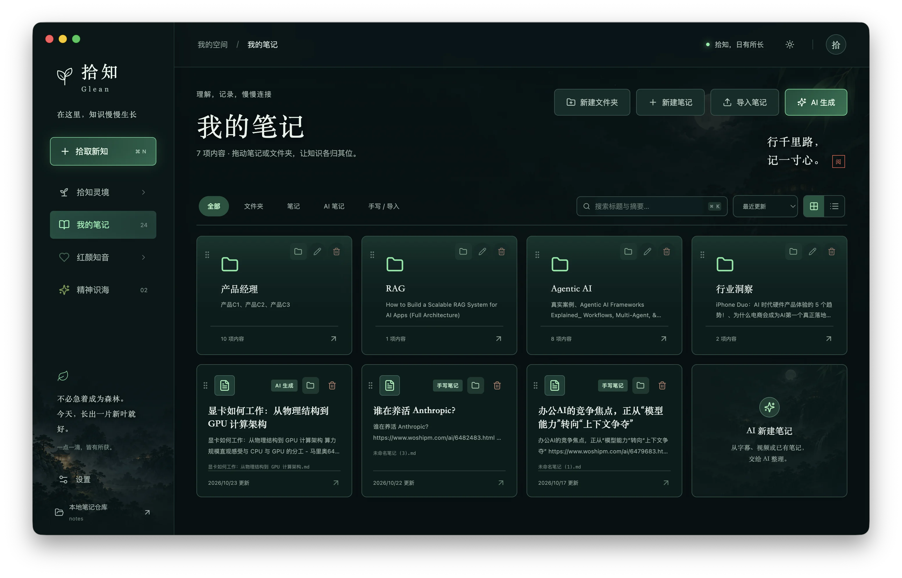
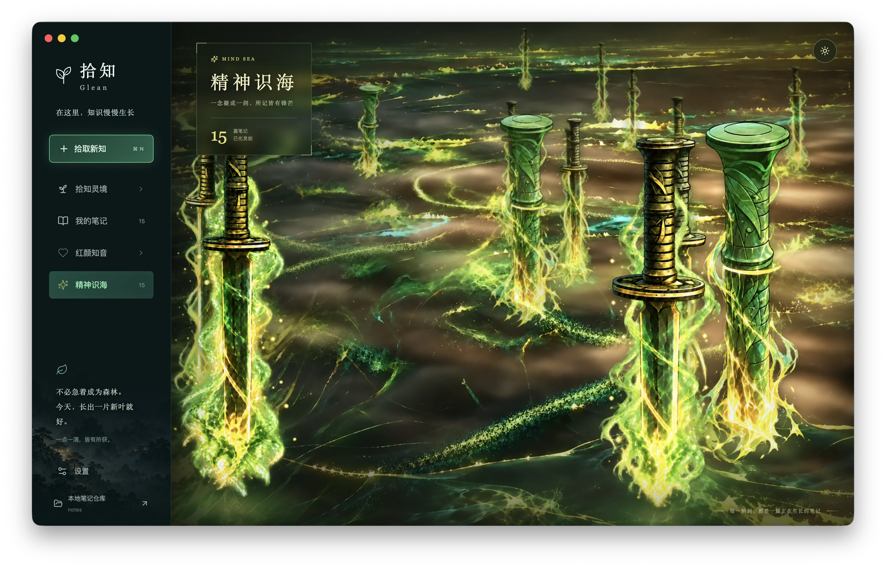

<div align="center">
  
  <h1>拾知 Glean</h1>
  <p><strong>让散落在视频、字幕与笔记里的知识，长成自己的修为。</strong></p>
  <p>一款本地优先的 AI 桌面知识库：从材料整理、深度追问到长期沉淀，都在同一个安静的阅读空间里完成。</p>
  <p>
    <a href="#产品体验">产品体验</a> ·
    <a href="#开始使用">开始使用</a> ·
    <a href="#从源码运行">从源码运行</a> ·
    <a href="#数据与隐私">数据与隐私</a>
  </p>
</div>



<p align="center"><sub>真实 macOS 应用界面 · 深色模式</sub></p>

## 不只是把内容变短，而是把知识留下来

收藏夹越来越长，真正能复述、能连接、能再次使用的内容却没有变多。拾知把学习过程收束成一个完整闭环：

```text
字幕 / 视频 / Markdown
        ↓
  提炼结构与核心概念
        ↓
  阅读、追问、补齐理解
        ↓
  保存为本地 Markdown
        ↓
  在未来的学习中重新连接
```

它不是另一个信息收集箱，而是一处面向个人学习者的知识工作台。你负责好奇与判断，拾知负责减少转写、整理、检索和归档的摩擦。

## 产品体验

### 从完整材料，生成真正可复习的笔记

导入 `.txt` 字幕、本地 MP4 或已有 Markdown。拾知会阅读全文，提炼核心概念、关系与必要例子，而不是把长内容机械切碎后拼接。

- MP4 音轨由内置 FFmpeg 提取，并通过 MLX Whisper 在 Apple Silicon 上本地转写。
- 原始字幕完整保留，可随时查阅和导出。
- 生成结果直接进入本地笔记仓库，不需要再手动搬运。
- 超出模型上下文、输出被截断或图片遗漏时会明确停止，不静默保存残缺结果。

### 阅读、编辑与追问，在同一个页面完成



正文可直接编辑并自动保存；右侧对话会结合当前笔记与原始字幕回答问题。值得留下的解释可以成为紧邻原句的知识补丁，每一次修改都保留版本，可随时恢复。

双链不是装饰。点击 `[[关联笔记]]` 即可在工作区继续阅读，让一次追问自然通向下一篇知识。

### 把高密度观点，重新装订成一册灵卷



「灵卷」从已有笔记中提炼值得反复回看的摘要，以沉浸式双页书册重新呈现。你可以逐页翻阅、回到原笔记继续深挖，也可以随时移除不再需要的摘要——让真正重要的知识，从信息流中重新浮现。

### 你的文件，始终归你



每篇内容都是普通 Markdown 文件。你可以选择任意本地目录作为仓库，并像整理真实书架一样创建多级文件夹、拖动归类、搜索、筛选、导入或导出。

拾知同时维护本地 SQLite 索引，用于保存字幕、对话、版本和学习统计；即使离开应用，Markdown 正文依然可读、可迁移、可被其他工具继续使用。

### 从“问一篇”到“问整个知识库”


「红颜知音」会检索你的个人笔记，再组织回答，并把实际参考的笔记展示在一旁。知识库没有命中时，它会明确说明答案来自模型通用知识，不伪造引用。

六位知识伙伴、明暗主题和可自定义背景，让长期学习不必只剩下工具感；视觉可以有温度，来源仍然要可信。

### 让长期积累，拥有自己的形状



「精神识海」把持续积累的笔记化作悬浮于识海中的飞剑。这里没有虚构的成就数据：每一次变化都来自真实记录，让原本抽象的长期主义，成为看得见的成长景观。

## 为什么选择拾知

| 你真正关心的事 | 拾知的回答 |
| --- | --- |
| 视频太长，整理成本太高 | 本地转写音频，保留真实时间戳，再生成结构化笔记 |
| 摘要看过就忘 | 在正文旁继续追问，把高价值解释沉淀为可恢复的知识补丁 |
| AI 回答不知道从哪来 | 展示实际命中的个人笔记；未命中时明确告知 |
| 笔记被锁在应用里 | 正文保存为本地 Markdown，目录结构与磁盘同步 |
| 积累没有反馈 | 首页展示学习足迹、知识连接与成长数据；每 10 篇笔记在「精神识海」凝成一柄飞剑 |
| 担心音频上传 | 视频转写完全在本机完成，不调用云端语音 API |

此外，拾知还提供：

- 「拾知灵境」：学习统计、最近半年足迹、每日修行与最近笔记。
- 「灵卷」：从笔记中收集高密度观点，让重要句子重新出现。
- 「精神识海」：把长期积累变成可见的成长景观。
- 任务进度：实时查看生成、转写和失败原因，失败任务可重试。
- 深浅主题：在工作台、阅读页与沉浸场景之间保持一致体验。

## 开始使用

当前已验证平台为 **macOS Apple Silicon**。本地构建使用 ad-hoc 签名，尚未进行 Apple 公证；Windows、Linux 与 Intel Mac 的发布构建尚未验证。

首次打开后：

1. 进入「设置」，填写 Chat Completions 兼容接口的 Base URL、模型名称和 API Key。本地免密模型可以留空 Key。
2. 选择主要转写语言。中文课程建议使用「普通话 / 中文」，中英混合内容可使用自动检测。
3. 点击左下角「本地笔记仓库」，选择 Markdown 的保存目录；不选择时会使用应用数据目录内的 `notes/`。
4. 点击「拾取新知」，导入 `.txt`、MP4 或 Markdown；也可以直接新建空白笔记。
5. 在阅读页继续编辑、追问和建立双链，让新内容进入已有知识网络。

> [!NOTE]
> 本地语音模型为 Large V3 Turbo 4-bit，约 455 MB，随正式应用包安装。首次转写不需要下载模型，也不需要配置语音服务。

## 从源码运行

环境要求：Node.js 22.12+、Python 3.11+，推荐使用 [`uv`](https://docs.astral.sh/uv/)。

```bash
git clone https://github.com/qfzhao670/Glean.git
cd Glean

uv venv --python 3.11
uv pip install -r backend/requirements.lock
npm ci
npm run desktop
```

`npm run desktop` 会构建前端、启动本地 Python 服务并打开 Electron 窗口。

开发预览：

```bash
npm run dev
```

然后访问 `http://127.0.0.1:5173`。浏览器预览需要手动填写仓库绝对路径；目录选择、打开仓库和显示文件位置等原生能力仅在桌面版提供。

> [!IMPORTANT]
> `npm run dev`、`npm run desktop` 与打包流程会依次从 `GLEAN_BUNDLED_MODEL_DIR`、项目 `.glean/models/` 和 macOS 应用数据目录查找 `whisper-large-v3-turbo-4bit`。构建脚本不会自动下载模型。

## 构建与验证

```bash
npm run build       # TypeScript 检查 + Vite 生产构建
npm run test        # 前端逻辑测试 + Python 后端测试
npm run package     # 打包 Python、FFmpeg、语音模型与 Electron 应用
```

测试覆盖笔记生成、上下文限制、字幕合并、仓库迁移、文件冲突、版本恢复、密钥脱敏、任务重试以及本地转写链路。更完整的验证记录见 [`docs/verification.md`](docs/verification.md)。

## 数据与隐私

拾知以本地可控为默认，但“本地优先”不等于所有 AI 能力都自动离线：

| 数据 | 保存或处理位置 |
| --- | --- |
| Markdown 正文与图片 | 你选择的本地笔记仓库 |
| 索引、字幕、对话、版本与统计 | 本地 SQLite 数据库 |
| MP4 音轨与语音转写 | 本机 FFmpeg + MLX Whisper，不发送到语音服务 |
| 生成笔记与知识问答 | 发送到你在设置中配置的文本模型 |
| API Key | 当前用户可读的本地 `settings.json`，默认脱敏展示；尚未使用系统钥匙串加密 |

本地 API 只监听 `127.0.0.1`，每次桌面启动都会生成随机会话令牌。Electron 渲染进程启用 sandbox 与 context isolation，并关闭 Node 集成。

> [!TIP]
> 只备份 Markdown 仓库不会包含聊天、历史版本和学习统计。完整备份还应包含应用数据目录。

## 当前边界

- 不直接抓取 YouTube、哔哩哔哩等平台链接；请导出字幕或下载为本地文件后导入。
- 本地语音识别目前只支持 Apple Silicon Mac。
- 知识库问答采用本地关键词片段检索，不依赖向量数据库。
- 全文生成受所选文本模型的上下文容量与输出质量影响。
- 当前不自动监听或同步外部 Markdown 编辑；检测到文件冲突时会阻止覆盖。
- 暂不包含账户、云同步、多用户、课程推荐或社区功能。

## 技术架构

```text
src/                    React + TypeScript 产品界面
src/components/         工作台、笔记库、编辑器、知识问答与成长场景
backend/glean/          FastAPI、本地工作流、SQLite、媒体与模型调用
backend/tests/          工作流、数据安全和媒体集成测试
desktop/                Electron 主进程与最小化 preload 桥接
scripts/                开发、模型暂存、检查与打包脚本
docs/                   产品设计、真实截图与验证记录
```

核心技术：React 19、TypeScript、Vite、Electron、FastAPI、SQLite、FFmpeg 与 MLX Whisper。

---

<div align="center">
  <strong>拾起一份新知，让它在自己的知识世界里继续生长。</strong>
</div>
